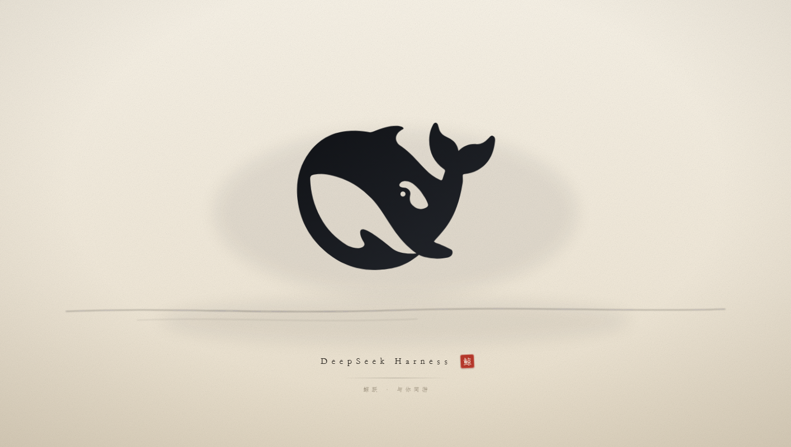
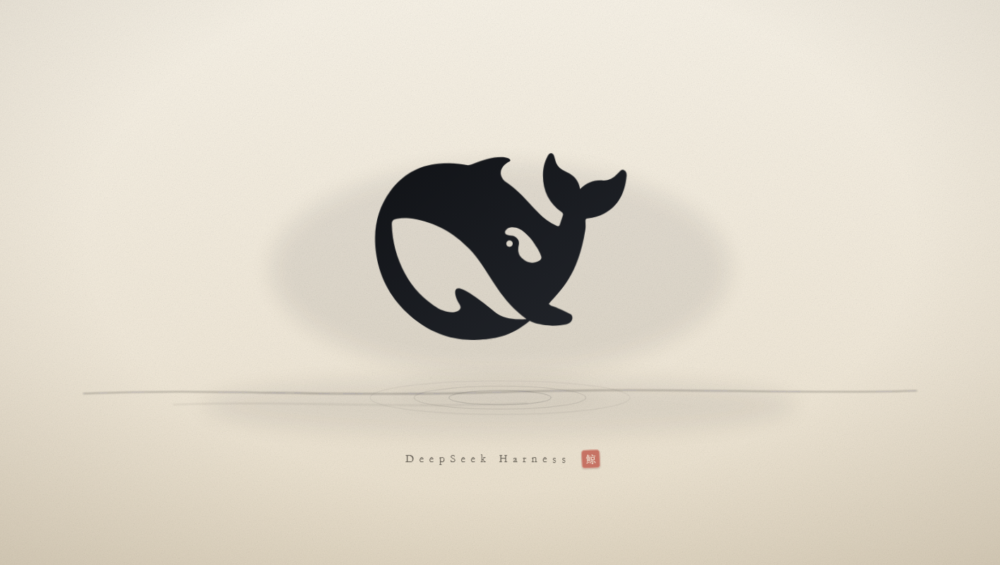

# Ink Whale Leap · 水墨鲸跃

A DeepSeek Harness (DSH) plugin that plays a short ink-wash whale-leap animation over the web UI when the page loads, then fades out by itself.



[中文说明](README.zh.md)

## What it shows

A full-window overlay in the palette of an ink wash on paper: the whale rises out of the still water, three ink rings spread from the waterline, a few ink drops scatter upward, and the wordmark `DeepSeek Harness` settles in with a red `鲸` seal and the line `鲸跃 · 与你同游`.

- 3.95 s after the page loads the overlay fades, and it is removed from the DOM at 4.75 s.
- `Esc` dismisses it immediately.
- With `prefers-reduced-motion: reduce` the animations are turned off.
- If the tab is hidden when the page loads, playback waits for the tab to become visible (15 s fallback).
- The overlay is decorative: `aria-hidden="true"`, `pointer-events: none`, so it never takes clicks or keyboard focus.



## Install

Once the plugin is listed in the DSH plugin market, install it from Settings → Plugins. From a command line:

```
dsh plugin add dsh-ink-whale-leap
```

The package declares `dsh.bundle.patch`, so installing it adds one loader row — there is no client bundle to approve.

## Preview without installing

Open `preview.html` in a browser from a checkout of this repository; it loads `splash.js` against a blank page.

## How it works

This is a host-only plugin. It reacts to `webserver/index-inject` by pushing a single inline `<script>` row, and serves the animation source at `/ink-whale/splash.js` from the `webServer` service.

There is deliberately no client entry point: in DSH, a client bundle that fails to activate aborts the web boot, and a launch animation is not worth that risk. Every step of activation is wrapped in `try/catch`, so a missing service or a failing injection leaves the app untouched instead of breaking it.

The animation itself is one self-contained IIFE with inline CSS and SVG (`splash.js`) — no network requests, no fonts, no images.

## Configuration

None. The plugin has no settings page and no options.

## Uninstall

Remove it the same way as any other plugin (market uninstall, or `dsh plugin remove dsh-ink-whale-leap`).

## Notes

- The animation runs once per page load, on every window that loads the web UI — it is not a once-per-install welcome screen.
- It only paints over the web UI; the desktop window chrome is unaffected.

## License

MIT
